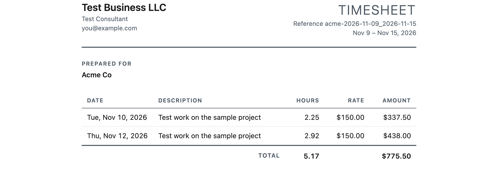

# timesheet

A Claude Code plugin that tracks your billable time on client work and turns it into a timesheet and an invoice.

You work in Claude Code as usual. The plugin logs time in the background, works out which client and project it belongs to from where you were working, and at the end of each billing period gives you a timesheet PDF and invoice line items. Optionally it creates the invoice in Mercury, unsent, for you to review and send.



## What you need

- macOS or Linux.
- `python3` 3.9 or newer. There is nothing else to install.
- Chrome, Edge or Chromium if you want a PDF. Without one you get an HTML page you can print to PDF.

## Install

```
claude plugin marketplace add bluewhalelabs/timesheet
claude plugin install timesheet@timesheet
```

Restart Claude Code afterwards. If you use more than one Claude account (separate `CLAUDE_CONFIG_DIR` folders), install it in each account you want tracked: time is only logged in accounts where the plugin is enabled.

## Set up (about five minutes)

In Claude Code, run:

```
/timesheet:setup
```

Claude asks one question at a time:

1. Your name and business, as they should appear on the timesheet.
2. Your first client: their name and how to recognise their work. That can be a folder (`~/Code/ClientX`), a single git repo, or a whole Claude account.
3. Your hourly rate for that client.
4. How often you invoice them: weekly, every two weeks, twice a month or monthly.

It shows you the config before saving it, then runs a health check. From then on, any session inside that client's folder, repo or account is tracked. To add another client later, run `/timesheet:setup` again; each client has its own rate and billing period.

## Day to day

You do nothing while you work. When you want to know where you stand, ask:

```
/timesheet:status
```

```
Acme Co
Current period: Nov 16 – Nov 22, 2026 (ends Nov 22): 5.06 h
Last period: Nov 9 – Nov 15, 2026: not drafted
```

If a session should not be billed (an internal call, an experiment, fixing your own tools), run this inside it:

```
/timesheet:ignore
```

Changed your mind? Say "bill that session again" and Claude removes the mark once you confirm. Nothing is deleted when you ignore a session, so its time comes back exactly as it was logged.

## Pause and resume

Two ways to stop the clock, both ended with `/timesheet:resume`:

```
/timesheet:pause
/timesheet:away
```

Pause stops the clock entirely: nothing in that stretch is billed. Away stops counting only your own time, for when you step out and leave agents working: their time is still billed. `/timesheet:pause 2h` or `/timesheet:away until 17:00` resumes on its own, and `all` covers every client. Time is still recorded either way, and status, the report and the invoice draft tell you how many hours were left out. If you forgot to resume, `/timesheet:resume at 15:00` ends it at that time and you get the time after it back.

## Invoice a client

At the end of a billing period:

```
/timesheet:invoice acme
```

1. Claude works out the hours and amounts for the last complete period. The numbers come from the logged time and your rate; Claude never estimates or adjusts them.
2. Claude drafts a one-line description for each work session from what was done.
3. You review the draft: date, description, hours, rate, amount and total. Change any wording you like.
4. You approve it. Nothing is saved before that.
5. You get the timesheet PDF and the line items to paste into your invoicing tool.

Your client sees dates, descriptions, hours, your rate and the amount. Nothing on the timesheet says how the time was tracked.

To invoice a different period, name it: `/timesheet:invoice acme this`, or `/timesheet:invoice acme 2026-11-09_2026-11-15`.

## Commands

| Command | What it does |
|---|---|
| `/timesheet:status` | Hours so far this period, and which periods still need an invoice |
| `/timesheet:invoice [client] [period]` | Draft, review and produce an invoice |
| `/timesheet:report` | A quick table of hours and amounts by project |
| `/timesheet:ignore [session]` | Mark the current (or a named) session as not billable |
| `/timesheet:pause [2h \| until 17:00 \| all]` | Stop billing for a while; time is still recorded |
| `/timesheet:away [2h \| until 17:00 \| all]` | Stop counting your own time; agents keep working and stay billed |
| `/timesheet:resume [at 15:00]` | Start billing again, or fix a pause you forgot to end |
| `/timesheet:setup` | First-time setup, or add a client |
| `/timesheet:doctor` | Check that everything is working |

You can also ask in plain words: "timesheet status", "how many hours this week?", "invoice Acme for last week", "ignore this session", "bill that session again", "pause the timesheet", "I'm stepping away for an hour", "I'm back", "I forgot to resume, I was back at 3pm", "change Acme's rate to 175".

## Reminders and the status line (optional)

Both are off until you ask for them. Tell Claude "remind me when an invoice is due" or "show my hours in the status line", or set them in `~/.timesheet/config.json`:

```json
{
  "status": {
    "components": ["invoice_due", "current_hours"],
    "show_amounts": false,
    "reminders": "daily"
  }
}
```

- `components` chooses what is shown and in what order: `client`, `invoice_due`, `current_hours`.
- `show_amounts` adds dollar amounts next to the hours. It is off by default, so a shared screen shows hours only.
- `reminders` is `off`, `session_start` or `daily`. When an invoice is due for the client you are working for, you see one line when a session starts:

```
timesheet: Invoice due: Nov 9 – Nov 15 (12.40 h). Run /timesheet:invoice acme
```

The status line shows the same information at the bottom of Claude Code, for example `Invoice due: Nov 9 – Nov 15 (12.40 h) • Current hours: 5.06 h`. Only the client you are currently working for is ever shown.

## Connect Mercury (optional)

With Mercury connected, the invoice flow ends by creating the invoice in your Mercury account. It is always created unsent: you open it in Mercury, attach the timesheet PDF and send it yourself.

1. In Mercury, create an API token with read and write access. Mercury requires you to list the IP addresses the token may be used from.
2. Put the token in your shell profile, not in the config and not in chat:

   ```
   export MERCURY_API_KEY="your-token"
   ```

3. Tell Claude "set up Mercury for Acme". It finds the customer and the receiving account in Mercury and updates the config.

After that, `/timesheet:invoice` shows you exactly what would be sent to Mercury and creates the invoice only when you say yes. It will not create a second invoice for the same period.

Mercury deletes tokens that go unused for 45 days, and downgrades read-and-write tokens that have not written anything in 45 days. If you invoice monthly or take a break, you may need a new token.

## Changing things

Ask Claude ("bill Acme monthly", "round to the quarter hour", "one line per day instead of per session"), or edit `~/.timesheet/config.json`. The most common settings:

| Setting | What it does | Default |
|---|---|---|
| `hourly_rate` | Rate per hour; can differ per client and per project | 150 |
| `billing_period` | `weekly`, `biweekly`, `semimonthly` or `monthly` | weekly, starting Monday |
| `rounding` | Round each line's hours, for example up to the next 0.25 | nearest 0.01 |
| `line_items` | One invoice line per `session`, `day`, `project` or `period` | `session` |

Time outside Claude Code (calls, email) can be added as manual entries. Every setting, how time is counted, and troubleshooting are in the [reference](docs/reference.md).

## Your data

Everything stays on your machine, in `~/.timesheet/`. The log holds timestamps, the session id, the client, the project and the working directory. It never holds what you or Claude wrote. Transcripts are read locally only while drafting descriptions, and the only text saved is the descriptions you approve. Nothing leaves your machine unless you connect Mercury, and then only the invoice you approve.

## If something looks wrong

Run `/timesheet:doctor`. It checks the config, the tracking hooks, the PDF browser and the Mercury token, and says what to fix. The most common cause of missing time is working in a Claude account where the plugin is not installed.

## Licence

MIT. See `LICENSE`.
