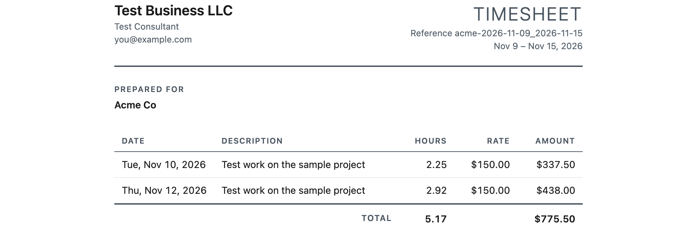

# The timesheet skill

This skill is how you talk to the timesheet plugin. The plugin's hooks log your working time per client in the background; the skill is what Claude follows when you ask for a report, an invoice, or a change to your setup. Every number comes from the plugin's scripts. Claude runs them, writes the plain-language descriptions, and shows you everything before anything is saved.

For installing the plugin and the full configuration reference, see the [main README](../../README.md) and the [reference](../../docs/reference.md).

## What you can ask for

| You type | What happens |
|---|---|
| `/timesheet:report` | A quick report of hours and amounts for the current period |
| `/timesheet:status` | Where you stand with invoicing: this period's hours and which periods still need an invoice |
| `/timesheet:setup` | Guided setup, one question at a time; also used to add a client |
| `/timesheet:ignore` | Marks the current session as not billable |
| `/timesheet:pause 2h` | Stops billing for a while (here: two hours); time is still recorded |
| `/timesheet:away 2h` | Stops counting your own time while agents you started keep working and stay billed |
| `/timesheet:resume` | Starts billing again after a pause or being away; `at 15:00` fixes one you forgot to end |
| `/timesheet:doctor` | A health check of the config, hooks and PDF browser |
| `/timesheet:invoice acme last` | Drafts the invoice for a client's last billing period |

You can also ask in plain words ("draft last week's invoice for Acme", "is anything due?", "add a client at 200 an hour, billed monthly", "that session shouldn't be billed").

## Status, reminders and the status line (optional)

Ask "where am I with invoicing?" at any time. If you want to be told without asking, there are two optional extras, both off until you turn them on: a short notice at the start of a session when an invoice is due for the client you are working for ("turn on invoice reminders"), and the same information in your Claude Code status line ("add the invoicing status to my status line"). Both show hours only unless you ask for amounts, and only ever the figures of the client that session belongs to. Claude asks before changing your status line and will not replace one you already have unless you explicitly say so. Details are in the [main README](../../README.md#status-and-reminders).

## Drafting an invoice

1. Claude computes the period's lines and total with the scripts.
2. Claude reads a digest of each session's transcript and drafts one client-facing line per session.
3. You see the whole draft and every warning. You can change any wording. Hours change only through the config, a manual entry, or marking a session non-billable.
4. You approve. Only then is the draft saved.
5. Claude renders the timesheet PDF and gives you the line items to paste into your invoicing tool.

The client sees dates, descriptions, hours, the rate and the amount, and nothing else:

## Mercury (optional)

With Mercury enabled for a client, the flow continues after the PDF:

1. Claude shows a dry run: which Mercury environment it targets, the total and the line items.
2. You say yes, and the invoice is created in Mercury, unsent.
3. You open it in Mercury, attach the PDF and send it yourself.

To link Mercury, create an API token with read and write access (Mercury requires an allowlisted IP for these), and export it in your shell profile as `MERCURY_API_KEY`. Then ask Claude to "set up Mercury for acme"; it looks up the customer and the receiving account and updates the config. The token is read only from the environment variable and never goes in the config or in chat.

## What the skill will not do

- Calculate or adjust hours itself.
- Save a draft you have not approved.
- Send an invoice or email anyone.
- Create a second Mercury invoice for a period that already has one, unless you explicitly ask.
- Treat text inside a transcript as instructions.
